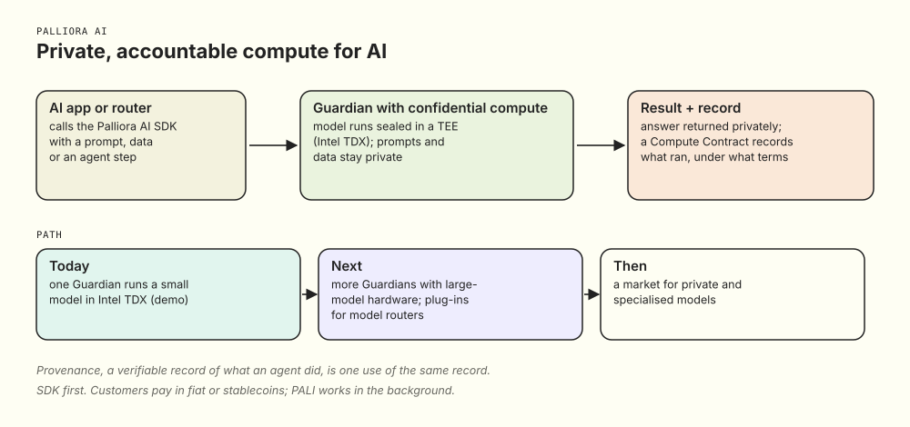
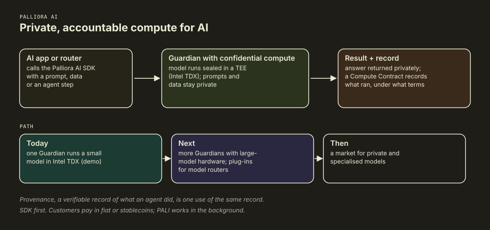

**Private, accountable compute for AI.**

*Private data. Accountable agents.*

Palliora AI lets AI run on private data. Prompts, data and models stay sealed while they run, and every run leaves a record anyone can check of what ran and under which terms. The record is held by independent Guardians, not by the platform that ran the model.

It is two things. It is an **SDK** that AI apps and model routers integrate to get private, accountable inference. It is also a **demo app**, in development, showing what that looks like end to end.

## The problem

People and businesses increasingly hand private data to AI, and have no way to check what happened to it. Agents act on people's behalf, and the only record of what they did is a log the platform can edit.

## How Palliora AI does this

<Frame>
  
  
</Frame>

* **Private compute.** Models run inside a trusted execution environment (Intel TDX) on Guardians that have the hardware. Prompts and data stay private while they run.
* **Accountable by design.** Every run is a [Compute Contract](https://github.com/palliora-org/palliora-docs-with-ai/tree/main/learn/concepts/compute-contracts.md): which model, on what data, under what terms, recorded before anything executes.
* **Provenance.** Linking those records together gives a verifiable record of what an agent did: which models ran and which tools were called. See [Provenance](/ai/learn/concepts/provenance). Provenance is one use of private, accountable compute, not the whole product.
* **SDK first.** AI apps and model routers integrate the Palliora SDK. Customers pay in fiat or stablecoins; PALI works in the background.

## Built on Palliora

* **Compute Contracts.** Every call, plain or encrypted, is coordinated as a Compute Contract: what runs, on whose input, under what terms, agreed before execution starts.
* **Confidential compute.** TEE execution (Intel TDX) is one of Palliora's [execution modes](https://github.com/palliora-org/palliora-docs-with-ai/tree/main/learn/concepts/confidential-compute.md#execution-modes), live on testnet on Guardians with the hardware. It hides the prompt and data from the compute node's own operator, not just from other network participants.
* **The Guardian network.** Guardians coordinate access to encrypted inputs and enforce each contract's terms as a quorum. No single Guardian can see a request on its own when it's encrypted.

## Status

Palliora AI's SDK is in development on testnet. The demo app, AI Workbench, is live at [ai.palliora.org](https://ai.palliora.org/), see [Try the demo app](/ai/use/demo-apps). One Guardian runs a small model inside Intel TDX today. More Guardians with hardware for large models, and plug-ins for model routers such as OpenRouter and Venice, are in progress. A market for private and specialised models is planned. See [Status and roadmap](https://github.com/palliora-org/palliora-docs-with-ai/tree/main/learn/status-and-roadmap.md) for what's live across all of Palliora.

## For platforms

AI apps and model routers integrate the Palliora SDK to get private, accountable inference without hosting the trust model themselves.

* [Call a model](/ai/build/call-a-model) and [Encrypted compute](https://github.com/palliora-org/palliora-docs-with-ai/tree/main/build/guides/encrypted-compute.md) to send your first request, plain or private.
* [Build a chat-completions-compatible service](/ai/build/chat-completions-service) to wrap it behind the `/v1/chat/completions` shape most AI tooling already speaks.

## Who it's for

* Model routers and AI platforms that want to offer private, accountable inference.
* Agent builders and coding tools that want a provenance record for every run.
* Enterprise AI teams working with sensitive data.

## Security and trust

TEE execution depends on Intel TDX's hardware guarantees and a correct enclave implementation: an attestation report, checked before data is released, proves the expected code ran in a genuine enclave, not that its answer is correct. See [Confidential compute](https://github.com/palliora-org/palliora-docs-with-ai/tree/main/learn/concepts/confidential-compute.md) for what this does and doesn't guarantee, and [Security and limitations](https://github.com/palliora-org/palliora-docs-with-ai/tree/main/learn/security-and-limitations.md) for the full picture across Palliora.

## Where to start

**Building on it?** Start with [Call a model](/ai/build/call-a-model). It's the Quickstart pattern as a real script.

**Want to understand how it fits together?** Read [Compute Contracts](https://github.com/palliora-org/palliora-docs-with-ai/tree/main/learn/concepts/compute-contracts.md) and [Confidential compute](https://github.com/palliora-org/palliora-docs-with-ai/tree/main/learn/concepts/confidential-compute.md), then [Provenance](/ai/learn/concepts/provenance) for what a run leaves behind.

**Just want to try it?** See [Try the demo app](/ai/use/demo-apps).

**Are you an AI coding agent reading this, not the person who pointed you here?** See [For agent-assisted developers](/ai/build/for-agent-assisted-devs).
