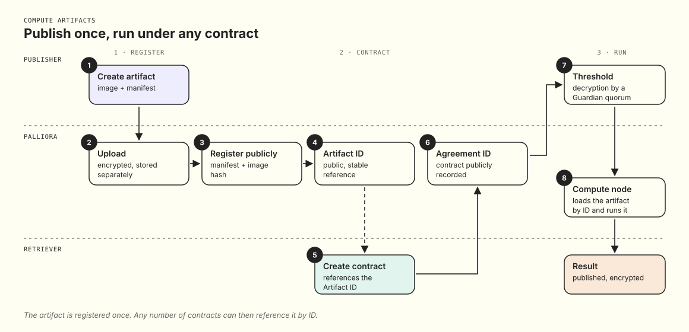
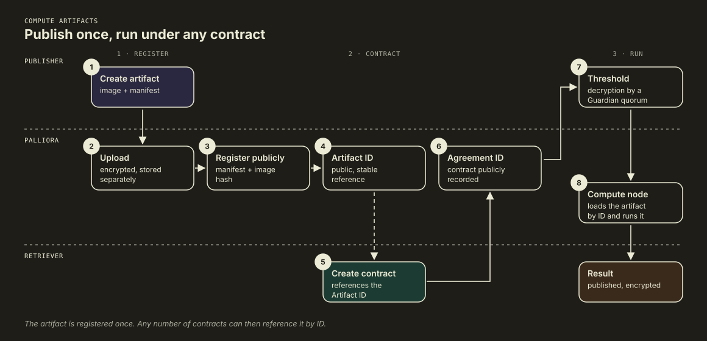

See [Compute Artifacts](/learn/concepts/compute-artifacts) for what an artifact actually is: a containerized image plus a manifest, registered once and referenced by any number of Compute Contracts afterward. This page covers the two practical paths: publishing one, and running one that's already published.

<Frame>
  
  
</Frame>

## Publish, through the Explorer

1. Open the Palliora Explorer and connect your wallet.
2. Go to the Agents tab.
3. Click "Upload Agent" in the top right.
4. Fill in:
   * Name and description.
   * Price: how much PALI you want to charge whoever runs your agent.
   * Container image: the reference to your agent's image on Docker Hub.
   * Environment variables, passed to the container alongside `docker run`. Include `TEST_OLLAMA_MODEL_ID`, the Ollama registry model ID your agent runs against, for example `TEST_OLLAMA_MODEL_ID=gpt-oss:20b`.
   * Port: the WebSocket port your container exposes for interaction, conventionally `8080`.
5. Click upload.

Behind the scenes, the Guardian network encrypts your agent's details with threshold encryption and uploads the encrypted reference to the Data Availability layer, emitting a `submitData` event. A `daccRegisterData` event follows with metadata referencing that upload. Both events together confirm the publish succeeded.

## Publish, programmatically

`palliora-sdk` doesn't yet have a dedicated high-level "publish an agent" helper the way it does for compute (`inferenceCompute`) or token transfers. The underlying registration is the same `submitData` plus `registerDataAgreement` pattern used for any threshold-encrypted Data Availability submission, see [SDK Reference: Data availability](/build/reference/sdk-reference#data-availability) and [Store data](/build/guides/store-data) for the concrete calls. If you're publishing programmatically rather than through the Explorer, build on that pattern directly.

The CLI's `upload-model` and `upload-dataset` commands exist but their handlers are currently unimplemented placeholders, don't reach for them yet.

## Run a published agent, through the Explorer

1. Go to the Agents tab on Palliora Explorer.
2. Select the agent you want to run.
3. Pay the PALI required.
4. You're redirected to a chat UI to interact with it.

## Run a published agent, programmatically

Discover what's published through the SDK's indexer client rather than querying the indexer's raw collections directly:

```ts
import { getArtefacts, getArtefact, getArtefactAccess } from "@palliora.org/chainsdk";

const artefacts = await getArtefacts(indexerClient, { storeType: "Agent" });
const one = await getArtefact(indexerClient, artefactId);
const access = await getArtefactAccess(indexerClient, artefactId);
```

Running an agent publicly submits `dataAvailability.daccRunAgent`, wrapped by the SDK's `runAgent()`:

```ts
import { runAgent } from "@palliora.org/chainsdk";

await runAgent(
  account,
  agentRef,       // OnChainRef: { blockNumber, index } of the agent's registration
  nonce,
  ciphertext,
  tdParams,
  pkBytes,
  tauParams,
  baseModel,       // OnChainRef for the base model, if applicable
  publicKey,
  guardians,
  guardian,        // optional: a specific guardian to target
  agreementId,     // optional
);
```

The parameters here (`nonce`, `ciphertext`, `tdParams`, `pkBytes`, `tauParams`) are the same threshold-encryption primitives used for any encrypted compute call, built from a guardian group the same way described in [Encrypted Compute](/build/guides/encrypted-compute). There's currently no simplified wrapper that hides this, if you're calling `runAgent` directly, read that page first.

Once submitted, this emits a `daccRunAgent` event. The Guardian network performs threshold decryption to expose the agent's container reference and environment variables to a compute node, which pulls the image, serves the model through Ollama, and starts the container. The result arrives as a `daccComputeResult` event; decrypting it gives you an `accessURL`, a WebSocket URL for your client to connect directly to the running agent.

This flow has several manual steps and little SDK-level sugar today. If you're building a new integration rather than maintaining an old one, the plain [Compute Contract](/learn/concepts/compute-contracts) path covered in [Quickstart](/build/quickstart) and [Encrypted Compute](/build/guides/encrypted-compute) is the more direct way to get a model to run something for you, agent publishing is specifically for the case where you want to package and sell a reusable agent, not run a one-off inference.
