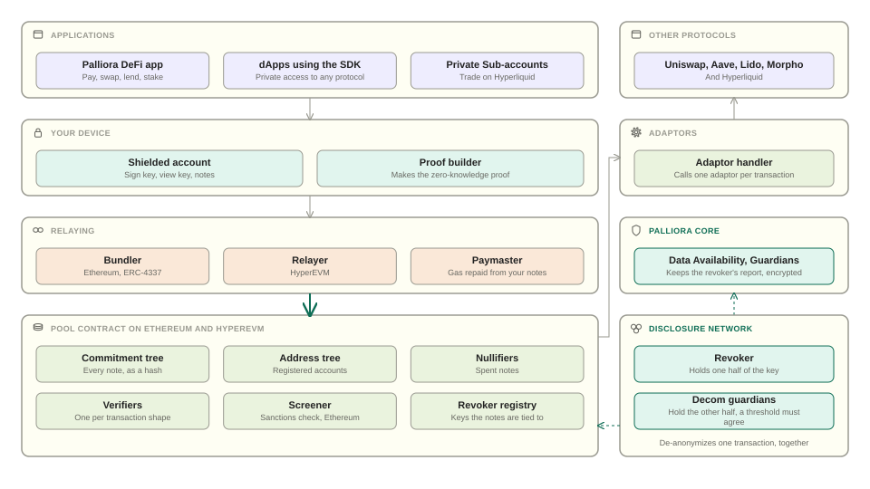
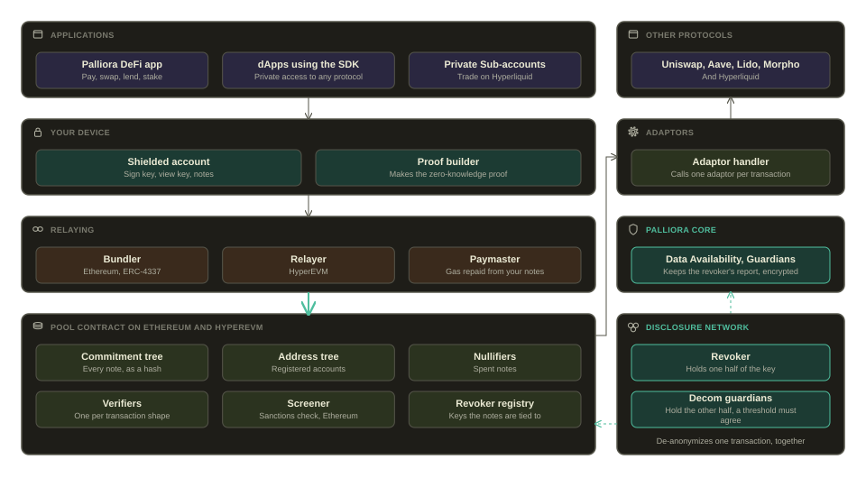

**Privacy for traders. Answers for regulators.**

Palliora DeFi (formerly Veilnyx) brings privacy to digital assets and DeFi on Ethereum and HyperEVM. It is built on Palliora, a privacy engine for blockchains and AI, so your assets stay on the networks you already use. You hold tokens in a shielded account, send them without showing who paid whom, and use DeFi protocols without tying that activity to your wallet. Disclosure is possible, but only through a process that no single party controls. A transaction that has been de-anonymized is kept on Palliora Core, which stores it encrypted.

It is two things. It is an **SDK** that exchanges, brokers, trading front ends and wallets integrate. It is also a **live product** on mainnet, with an app anyone can use today.

## The problem

A public ledger shows everything. Anyone can see your balance, who you pay, and what you trade. Fully private systems fix that, but then nobody can audit anything, so regulators and many institutions cannot use them.

Palliora DeFi keeps activity private by default and still lets a transaction be de-anonymized when there is a real reason. That takes agreement from more than one independent party, and what is de-anonymized stays protected on Palliora Core.

## How Palliora DeFi does this

<Frame>
  
  
</Frame>

Three pieces work together:

* **A shielded pool.** Tokens sit in one contract. Ownership is recorded as encrypted notes. A zero-knowledge proof shows that every transaction is valid without showing who sent it, who received it, or how much.
* **Relaying.** A relayer or bundler submits your transaction, so your wallet does not appear as the sender. Gas is paid from your shielded balance.
* **A disclosure network.** Every transaction carries an encrypted seed. Only a revoker and a threshold of Decom guardians, working together, can de-anonymize it. The revoker keeps what it de-anonymized on Palliora's Data Availability layer, encrypted. The revoker, or any third party the revoker grants access to, can read it.

## Built on Palliora

Palliora DeFi is built on Palliora Core, Palliora's privacy engine. A revoker keeps a de-anonymized transaction as an encrypted report on Palliora Data Availability. The report is protected by Palliora's silent threshold encryption layer and by Palliora Guardians. Palliora's Compute Contract coordinates both storing the report and retrieving it, for the authorized actors. See [Palliora integration](/defi/learn/concepts/palliora-integration).

## What is live today

Palliora DeFi is live on Ethereum mainnet and HyperEVM mainnet, and on two testnets: Sepolia and HyperEVM testnet.

* **Private payments.** Deposit, send and withdraw on both mainnets.
* **Private DeFi on Ethereum.** Swap on Uniswap, lend on Aave, stake on Lido, and deposit into Morpho vaults, all from your shielded balance.
* **Private trading on Hyperliquid.** From HyperEVM you trade perpetuals with [Private Sub-accounts](/defi/learn/concepts/private-sub-accounts).

The Palliora DeFi app is live at [defi.palliora.org](https://defi.palliora.org).

Launch limits are in force while the protocol is young. They will be increased in steps and announced here. See [Status and limits](/defi/reference/status-and-limits) for the current numbers.

## For platforms

Platforms integrate the SDK so their users get private balances and transfers without leaving the venue they know. Adaptors let a private transaction reach another protocol, and Private Sub-accounts let a front end offer private trading on Hyperliquid. Packages are published under `@palliora.org/defi-*`.

* [Quickstart](/defi/build/quickstart) and the [SDK reference](/defi/build/sdk-reference).
* [Integrate a DeFi protocol](/defi/build/integrate-a-protocol) to write an adaptor.
* [Private Sub-accounts SDK](/defi/build/private-sub-accounts-sdk) and the [Relayer API](/defi/build/relayer-api) for Hyperliquid.

## Who it is for

* Hyperliquid and other on-chain front ends that want to offer private trading.
* Web2 brokers and exchanges adding on-chain trading for their users.
* Trading firms and institutions that need execution without exposing strategy.
* Anyone who wants private payments and private DeFi from one shielded balance.

## Security and trust

* **Audit.** The protocol and circuits were audited by ABDK. Both Critical findings and all eight Major findings were fixed. The Hyperliquid components were reviewed internally. See [Security and audits](/defi/reference/security-and-audits).
* **ZK ceremony.** The proving keys come from a public Phase 2 ceremony, finalised on 2026-07-15 with 372 contributions. See [ZK ceremony](/defi/reference/zk-ceremony).
* **Sanctions screening** at deposit and registration on Ethereum.
* **Disclosure contact:** [security@palliora.org](mailto:security@palliora.org).

Palliora DeFi provides attribution privacy, not invisibility. Orders, prices and settlement on the network stay public. Who placed them does not.

## Where to start

**Building on it?** Go to [Quickstart](/defi/build/quickstart). Install the SDK and send your first private transaction.

**Want to understand how it fits together?** Start with [How Palliora DeFi works](/defi/learn/how-it-works), then read [Concepts](/defi/learn/concepts) for the pieces you want to go deeper on.

**Just want to use it?** Open the app at [defi.palliora.org](https://defi.palliora.org).

**Want to run infrastructure?** See [Participate](/defi/participate/participate) for running a Decom guardian.

**Looking for addresses, limits, fees or audit results?** They are in the [Reference](/defi/reference/network-reference) section.

**Are you an AI coding agent reading this, not the person who pointed you here?** See [For agent-assisted developers](/defi/build/for-agent-assisted-devs).
