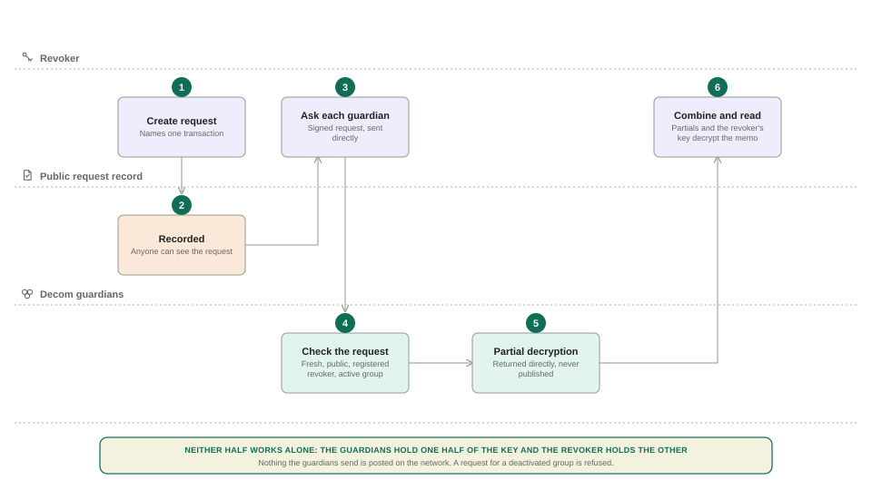
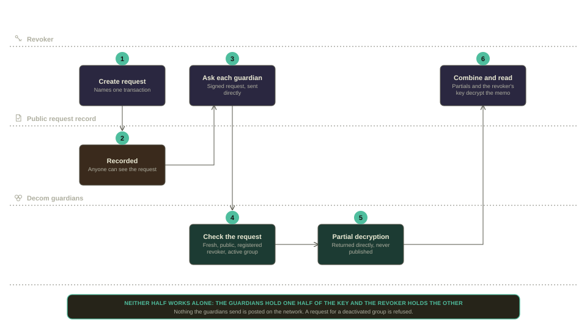

Palliora DeFi is private by default. It uses Palliora's accountable privacy: a transaction can still be de-anonymized when there is a real reason, but only through due process, and never through a master key. There are two ways. You can show your own history to someone you choose. Or a revoker and a group of Decom guardians can de-anonymize one transaction together.

## Who takes part

| Role            | Holds                                                       | Does                                                                                                                                                       |
| --------------- | ----------------------------------------------------------- | ---------------------------------------------------------------------------------------------------------------------------------------------------------- |
| You             | Your view key                                               | Can share your history with someone you choose.                                                                                                            |
| Revoker         | A private key, `r`                                          | Asks to de-anonymize a transaction. Your account is tied to one revoker when you set it up.                                                                |
| Decom guardians | One share each of a shared secret, `S`                      | Each answers a valid request with a partial decryption. A threshold of them must answer.                                                                   |
| Pool owner      | The owner key                                               | Can deactivate a revoker group, after which guardians refuse its requests.                                                                                 |
| Palliora Core   | Palliora Guardians, Data Availability and Compute Contracts | Keeps the report a revoker writes after de-anonymizing a transaction. A Compute Contract coordinates storing and retrieving it, for the authorized actors. |

A Decom guardian is a node run for Palliora DeFi. It is not a Palliora Guardian, which is part of Palliora's privacy engine. The two do different jobs. Decom guardians help de-anonymize a shielded transaction. Palliora Guardians protect the report that records what was de-anonymized. See [Palliora integration](/defi/learn/concepts/palliora-integration).

## The disclosure key

Every transaction includes a random seed, encrypted to one public key:

```
disclosure key = S times G, plus the revoker public key R
```

`S` is the guardians' shared secret. It is never put together in one place. `R` is `r` times `G`, from the revoker's private key. The proof of the transaction shows that the seed was encrypted correctly. The seed unlocks the transaction's memo, which holds the notes the transaction created and its sender. The pool stores this public key as `encryptionPublicKey` in each revoker's record.

To decrypt the seed you need two halves. One half is the guardians', and it takes partial decryptions from a threshold of them. The threshold is set when the group is created. The current group size and threshold are in the [Network reference](/defi/reference/network-reference). The other half is the revoker's own key. Neither half works alone.

## De-anonymizing one transaction

<Frame>
  
  
</Frame>

1. The revoker creates a request that names the transaction. The request is recorded publicly in the request contract.
2. The revoker's service sends a signed request to each guardian node.
3. Each node checks four things:
   * the request is fresh, no older than 60 seconds;
   * it exists in the public record and names this transaction;
   * the signer is the registered revoker for the group;
   * the group is active.
4. If the checks pass, the node computes its partial decryption and returns it directly in the reply. Nothing is published.
5. With a threshold of partial decryptions, the revoker combines them with its own key and recovers the seed.
6. The seed decrypts the memo. The revoker sees the notes the transaction created and who sent it.

Partial decryptions are never published. Anyone who held enough of them could de-anonymize the transaction without the revoker.

## Keeping what was de-anonymized

After the revoker reads a transaction, it can write a report of what it saw to Palliora's Data Availability layer. The report holds the notes the transaction created, its sender and the request that de-anonymized it.

* **The revoker seals it first.** The report is encrypted in the revoker's browser to a key that only the revoker's wallet can produce. Palliora's silent threshold encryption layer then encrypts it again to a group of Palliora Guardians.
* **A Compute Contract coordinates it.** The contract records the report, and it coordinates both storing it and retrieving it, for the authorized actors. The report stays available and unaltered.
* **The revoker decides who can read it.** The revoker is the default reader. The revoker can also give a third party access, such as an auditor or a regulator, with an access grant on the same contract. Palliora's Guardians rebuild the key and hand it only to the key the revoker names.

Writing a report does not change who can de-anonymize a transaction, and it changes nothing on the pool. See [Palliora integration](/defi/learn/concepts/palliora-integration) for how it works, what is public and what is not.

## What the guardians check, and what they do not

A guardian node checks that the request is real, public, and made by the group's registered revoker. It does not weigh the reason for the request. The people who run the revoker are responsible for the legal basis and for who may ask. If a revoker's key is compromised, the pool owner can deactivate its group. Guardians then refuse every request for that group, including old ones.

## What the revoker can do alone

The revoker's public key is part of every nullifier. With its private key, the revoker can recognise a note that a registered account spent, because it knows that account's view public key from registration. It can do this without asking the guardians. It still cannot read amounts, tokens or recipients.

The guardian threshold protects the contents of a transaction: the notes it created and who sent it. It does not hide from the revoker which registered account spent a note.

## Disclose your own history

You can give a view key to someone you choose, such as an accountant or a tax authority. The holder can read your balance and your transaction history. They cannot spend anything, because spending needs your sign key. You download the view key from the Activity page of the app.

## Keeping the keys safe

The guardians generate their shared secret with a distributed key generation. No node, and no operator, ever holds the whole secret. Operators can refresh the shares, change the threshold, replace the key, or swap nodes in and out. See [Guardian key operations](/defi/participate/guardian-key-operations).

## Limits

* A threshold of guardians together can rebuild `S`. They still need the revoker's key to de-anonymize a transaction.
* Replacing the key protects future transactions. Old transactions stay tied to the old key, so the old group must stay available while they matter.
* Accountable privacy gives accountability, not anonymity from the revoker. See the [Privacy model](/defi/learn/concepts/privacy-model).
* A report on Palliora is a record kept by the revoker. Palliora keeps it and controls access. It does not decide who may de-anonymize a transaction.

## Next

* [Palliora integration](/defi/learn/concepts/palliora-integration)
* [Private Sub-accounts](/defi/learn/concepts/private-sub-accounts)
* [Privacy model](/defi/learn/concepts/privacy-model)
