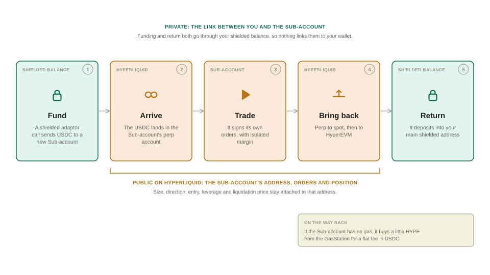
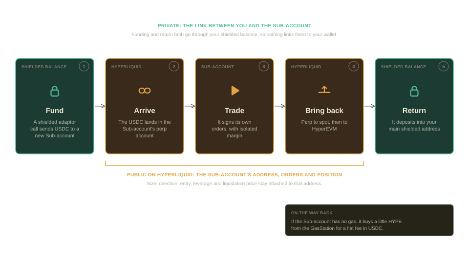

A Private Sub-account lets you trade perpetuals on Hyperliquid with private funding. You move money from your shielded balance into a fresh trading account that is not linked to you. You then trade from it directly.

## What is private and what is not

**Private funding of a public position. Not a private position.**

Size, direction, entry price, leverage and liquidation price are public on Hyperliquid. They stay attached to the Sub-account's address for good. What is hidden is the link between that address and you.

How well it stays hidden depends on the pool. The Sub-account is only as anonymous as the group of people moving similar amounts through the pool at similar times. See the [Privacy model](/defi/learn/concepts/privacy-model).

## How it works

<Frame>
  
  
</Frame>

1. **Fund.** You ask the app to open a position. It derives a new Private Sub-account and sends USDC to it from your shielded balance, in one shielded adaptor call. A relayer submits the call. The adaptor deposits the USDC into the Sub-account's Hyperliquid account through Circle's deposit contract.
2. **Arrive.** The USDC lands in the Sub-account's Hyperliquid perp account.
3. **Trade.** The Sub-account signs its own Hyperliquid orders, with isolated margin. No contract places the orders and no one holds the key for you.
4. **Close and bring back.** When you close, the money moves from perp to spot, then from Hyperliquid to HyperEVM.
5. **Return.** The Sub-account deposits the money into your main shielded address. The deposit does not say which account receives it.

On the way back, the Sub-account may have no HYPE for gas. The app buys a small amount from the GasStation for a flat fee in USDC. You sign that with the Sub-account's key, and the relayer submits it.

## Why a separate account

Hyperliquid's contract interface has no action to create accounts or to set margin mode. A contract could hold many users' positions in one account, but they would net into one position with one liquidation price, so one user's loss could affect another's. A separate account for each position keeps each one isolated and under your control.

## Keys

A Sub-account key comes from your shielded account's spending key and an index:

```
sub-account key = keccak256(spending key, network context, index)
```

The network context is different on mainnet and on testnet, so your mainnet and testnet Sub-accounts never share an address. You can always recover them from your wallet. The flip side is that anyone who gets your spending key can derive every Sub-account you have made.

## What the app does for you

* **A new Sub-account for each position.** The app does not reuse a spent one. Two positions on one address would link to each other.
* **Gas arrives safely.** The app never lets a Sub-account receive gas from your own wallet. That would link it to you for good.
* **Labels stay on your device.** Names and indexes never leave your device, including in analytics.

## What you can do to stay private

* Prefer round amounts. A withdrawal of 1,000 looks like many others. A withdrawal of 1,247.83 stands out.
* Choose your own timing. The app does not add a delay, because a forced delay would also slow you down when you need to add margin.
* Keep the way you trade varied across Sub-accounts. A steady style in size or timing can link them.
* Remember that the return deposit shows an amount. Profit and loss are rarely round numbers.

The relayer sees the Sub-account address, the amount and the time. It never sees who you are.

## Costs

A Sub-account trade has a relayer fee, a gas fee for the return, and a one-time charge by Hyperliquid on the first transfer out. See [Fees](/defi/reference/fees) for the amounts.

## Next

* [Private Sub-accounts SDK](/defi/build/private-sub-accounts-sdk)
