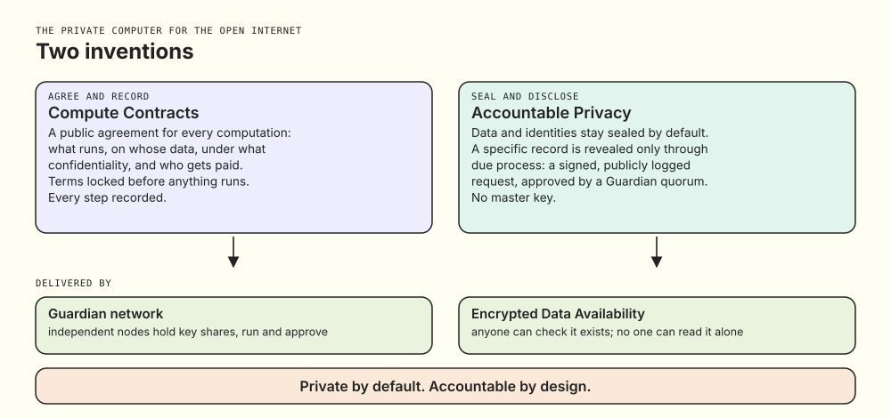
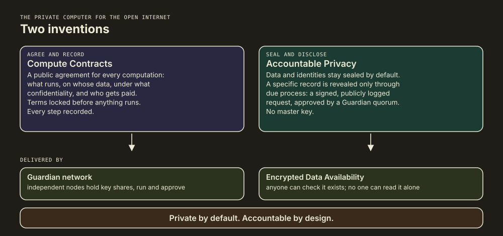

**The private computer for the open internet.**

Privacy is what lets people and businesses act freely. Accountability is what keeps everyone safe. Palliora is how the open internet gets both: private by default, accountable by design. See [Why Palliora](/why-palliora).

Palliora plugs into the chains and platforms you already use. Its Guardian network runs computation and moves value while keeping both private and accountable. Your users, assets and liquidity stay where they are. See [Where Palliora runs](/learn/where-palliora-runs).

It starts with finance and AI, the two places where private, accountable computation is needed most today.

## Two inventions

<Frame>
  
  
</Frame>

* **Compute Contracts.** A publicly recorded agreement that names what runs, on whose data, under what confidentiality, and who gets paid. Terms are locked before anything executes, and every step after that is recorded. Compute Contracts connect private, off-chain work to public, on-chain accountability. See [Compute Contracts](/learn/concepts/compute-contracts).
* **Accountable Privacy.** Data and identities stay sealed by default. A specific record can be revealed only when a signed, publicly logged request is approved by a quorum of independent Guardians, and only that record. Users can also share time-bound view keys on their own terms. See [Accountable privacy](/learn/concepts/accountable-privacy).

Two pieces of infrastructure deliver them:

* **The Guardian network.** Independent nodes that hold key shares, sign contracts, run computation and approve disclosure. No single Guardian can decrypt anything on its own. See [Guardian](/learn/concepts/guardian).
* **Encrypted Data Availability.** Data is encrypted before it reaches Palliora. Anyone can check that it exists and hasn't changed. No one can read it alone. See [Data availability](/learn/concepts/data-availability).

See [How Palliora works](/learn/how-it-works) for the full picture.

## Built on Palliora

Palliora's first two products are built in-house, as proof of what it can do and as SDKs for platforms to integrate:

* [**Palliora DeFi**](/products/palliora-defi): private trading on any chain, accountable to regulators. *Privacy for traders. Answers for regulators.*
* [**Palliora AI**](/products/palliora-ai): private, accountable compute for AI, from running models privately to a verifiable record of what an agent did. *Private data. Accountable agents.*

Anything else that needs private data with a public guarantee can be built the same way. See [What you can build](/products/use-cases).

## What's live today

Everything below runs on Manas, Palliora's public testnet, as Palliora prepares for mainnet.

* Guardians, validators and compute nodes, at about 700 transactions per second, 6-second blocks and 15 to 20 second finality.
* Confidential compute in Intel TDX on Guardians that have the hardware. Not every Guardian has it.
* Verifiers, checking results against each contract's own tests.
* Palliora DeFi, live on testnet on Hyperliquid and Ethereum, with a demo app.
* Palliora AI's SDK, in development on testnet: one Guardian runs a small model inside Intel TDX. Its demo app, AI Workbench, is live at [ai.palliora.org](https://ai.palliora.org/).
* A completed security audit.

For the full picture, see [Status and roadmap](/learn/status-and-roadmap).

## Where to start

| If you are…                                                      | Start here                                                                                                                                                                |
| ---------------------------------------------------------------- | ------------------------------------------------------------------------------------------------------------------------------------------------------------------------- |
| Evaluating Palliora or trying to understand how it fits together | [Why Palliora](/why-palliora), then [How Palliora works](/learn/how-it-works)                                                                                       |
| A platform that wants private trading or private AI              | [Products](/products/products)                                                                                                                                         |
| Building it yourself                                             | [Quickstart](/build/quickstart)                                                                                                                                        |
| Handing the build to a coding agent                              | [Build with a coding agent](/build/coding-agents/build-with-a-coding-agent)                                                                                            |
| Running infrastructure                                           | [Participate](/participate/participate)                                                                                                                                |
| Just trying it                                                   | [Try the Palliora DeFi demo app](/use/demo-apps) or the [Palliora AI demo app](https://github.com/palliora-org/palliora-docs-with-ai/tree/main/ai/use/demo-apps.md)    |
| An AI coding agent reading this page                             | [For agent-assisted developers](/build/coding-agents/for-agent-assisted-devs) and [llms.txt](https://github.com/palliora-org/palliora-docs-with-ai/tree/main/llms.txt) |
