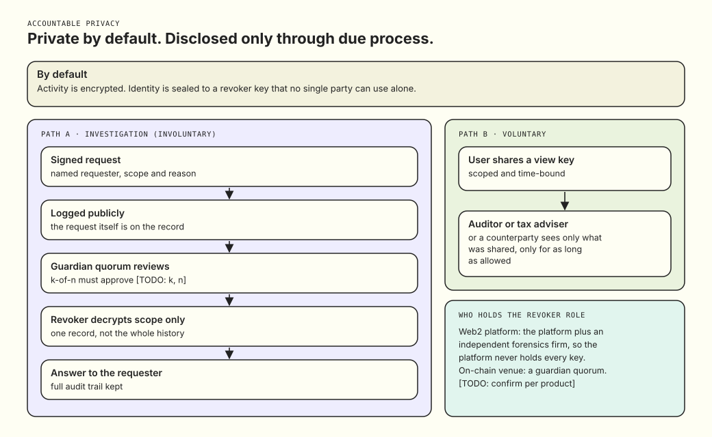
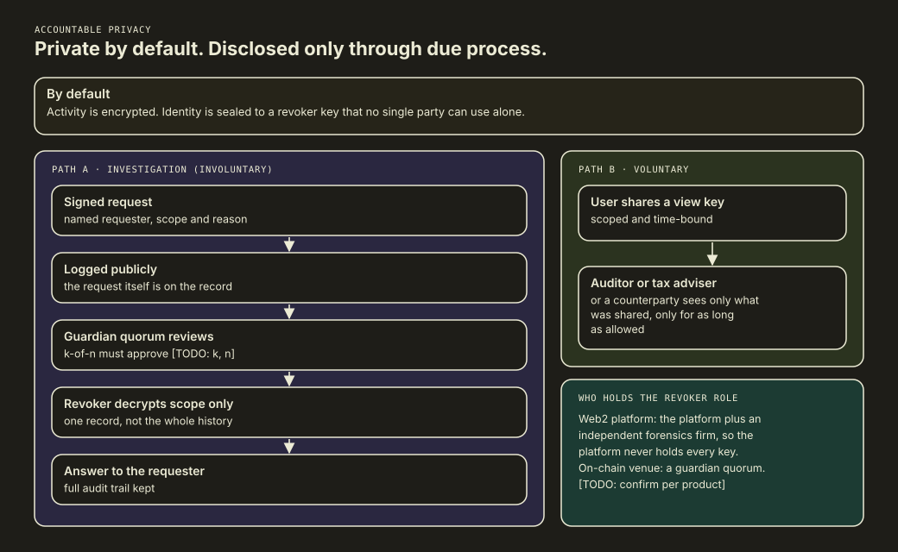

Accountable Privacy is one of Palliora's two inventions, with [Compute Contracts](/learn/concepts/compute-contracts).

> **Private by default. Accountable by design.**

Palliora keeps identity and activity private by default, and makes disclosure possible only through due process: a signed, public request, approved by independent Guardians, revealing only what the request covers.

<Frame>
  
  
</Frame>

## What it solves

Public systems expose everyone. Fully private systems can't answer a lawful question, so they get restricted or shut down. The obvious middle ground, giving one party a master key, means that party can see everything and becomes a single point of failure and abuse. Accountable privacy removes the master key and replaces it with a process.

## How it works

### By default, nothing is visible

When a user acts through a Palliora-powered application, their activity is encrypted and the link to their identity is sealed to a **revoker key**. No single party holds that key: not the application, not Palliora, not any one Guardian.

### Path A: investigation

When there is a real reason to look, for example evidence that an account is tied to illicit activity, disclosure follows a fixed process:

1. **A signed request.** A named requester submits the request with its scope and reason.
2. **Logged publicly.** The request itself is recorded, so disclosures can't happen quietly.
3. **Guardian quorum.** A threshold of independent Guardians must approve.
4. **Scoped decryption.** The revoker decrypts only what the request covers: one record, not the account's whole history.
5. **Audit trail.** The answer goes to the requester, and the whole process stays auditable.

Honest users are never exposed by default. No single party, including the revoker or any one Guardian, can unmask anyone on its own.

### Path B: voluntary disclosure

Users can prove things about their own activity without waiting to be asked. They can generate a **view key** that is scoped (which records) and time-bound (for how long), and share it with a tax adviser, auditor, counterparty or platform. They can also prove a position or history directly.

### Who holds the revoker role

| Setting                                 | Revoker                                                                                                       | Why                                                                              |
| --------------------------------------- | ------------------------------------------------------------------------------------------------------------- | -------------------------------------------------------------------------------- |
| Web2 platform, for example a broker     | The platform plus an independent forensics firm (for example Chainalysis or TRM Labs), as a two-party revoker | The platform never holds every key, so it can't unmask its own users on its own. |
| On-chain venue, for example Hyperliquid | A majority quorum of Guardians                                                                                | No company sits in the middle of an on-chain venue.                              |

### Screening at the door

Applications can screen deposits against sanctions lists before funds enter the private layer, so known bad actors are blocked rather than just recorded.

## What it isn't

* It isn't a backdoor. There is no master key and no silent access.
* It isn't surveillance. Nothing is watched by default. Disclosure needs a specific, logged, approved request.
* It doesn't decide who is guilty. It provides a fair process for revealing a specific record when the people responsible for that decision ask through it.

## How it fits into Palliora

Accountable privacy is built from the other concepts. [Threshold encryption](/learn/concepts/threshold-encryption) splits the keys, [Guardians](/learn/concepts/guardian) approve requests, [Compute Contracts](/learn/concepts/compute-contracts) carry the rules, and the coordination ledger records every request.

## Where to go next

* [Threshold encryption](/learn/concepts/threshold-encryption): how the keys are split.
* [Guardian](/learn/concepts/guardian): who reviews disclosure requests.
* [Palliora DeFi](/products/palliora-defi): accountable privacy applied to trading.
