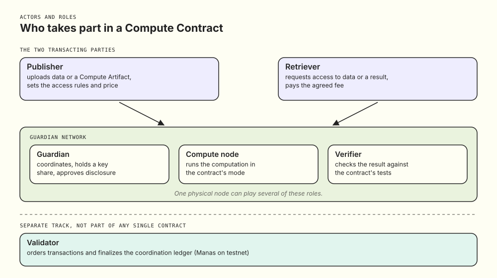
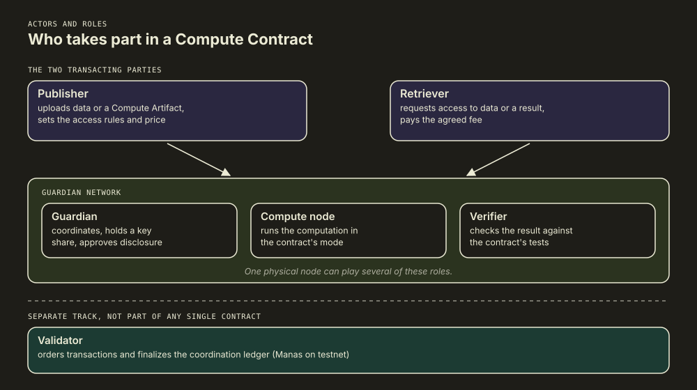

A Compute Contract involves six roles. Each one is incentivized separately, and each one is independently verifiable: no role has to trust another role's good intentions, only the contract and the protocol enforcing it.

<Frame>
  
  
</Frame>

| Role         | What it does                                                                                                                                                                                                                           | What it's paid for                                          |
| ------------ | -------------------------------------------------------------------------------------------------------------------------------------------------------------------------------------------------------------------------------------- | ----------------------------------------------------------- |
| Publisher    | Uploads data or a Compute Artifact. Sets the access rules and price. Can be a data owner, a model developer, or a dApp itself.                                                                                                         | Receives the price it set when its data or artifact is used |
| Retriever    | Requests access to data, or to a computation's output. Receives only what the contract explicitly permits.                                                                                                                             | Pays the contracted fee in PALI                             |
| Guardian     | Coordinates protocol execution, holds a decryption key share, enforces the contract's conditions and reviews disclosure requests. Byzantine fault tolerant as a group.                                                                 | Earns a share of the threshold decryption fee               |
| Compute node | Executes the computation itself, in the execution mode the contract specifies: trusted or TEE (Intel TDX, on Guardians with the hardware) today, SMPC and FHE on the roadmap. Also called a Calculator in the SDK and on palliora.org. | Earns a compute fee for each result                         |
| Verifier     | Attests that inputs and outputs meet the contract's own tests. A majority verdict is binding; a minority that disagrees loses its fee.                                                                                                 | Earns a fee for each result it verifies                     |
| Validator    | Runs the coordination ledger: orders transactions and maintains state.                                                                                                                                                                 | Transaction fees plus staking rewards                       |

A single physical node is often more than one of these roles at once. A Guardian node, in particular, is an umbrella: the same node can act as a standard Guardian, a compute node, and a Verifier, depending on what a given contract asks it to do and how its operator has configured it.

## Publisher and Retriever

Publisher and Retriever are the two sides of a data or compute transaction. The Publisher decides what's shared and sets a price; the Retriever pays that price to get access. Neither has to trust the other directly: the contract and the Guardian network that enforces it stand in between.

## Guardian, compute node, verifier

These three roles are what actually make a Compute Contract execute safely. See [Guardian](/learn/concepts/guardian) for how the Guardian role works, and [Confidential Compute](/learn/concepts/confidential-compute) for what a compute node guarantees in each execution mode. A Guardian must stake at least a minimum amount of PALI to join the network in this capacity.

## Validator

Validators are a separate track from the Guardian, compute node and verifier set: they secure the coordination ledger rather than taking part in any individual compute contract. See [Validator](/learn/concepts/validator).

## Where to go next

Building something that plays one of these roles (most commonly Publisher, Retriever, or Guardian) starts at [Quickstart](/build/quickstart). Running infrastructure (Guardian or Validator) starts at [Participate](/participate/participate).
