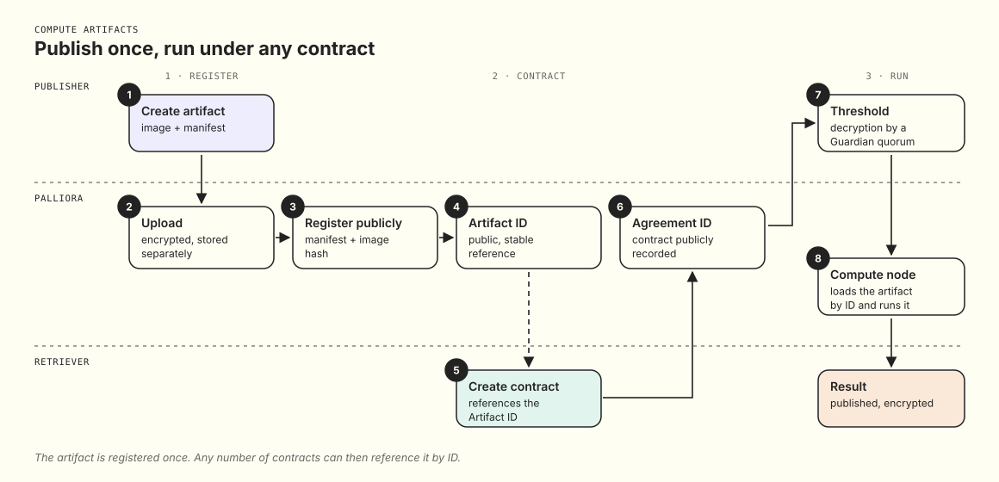
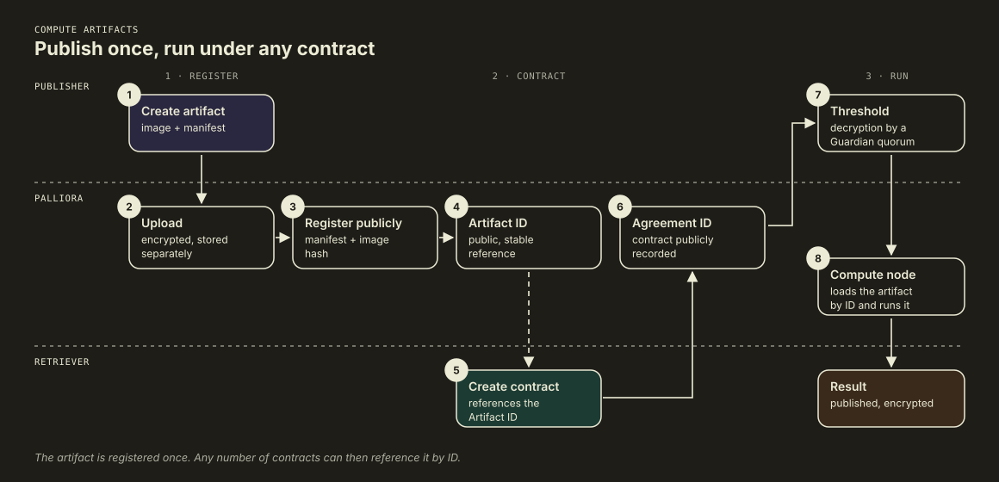

A Compute Artifact is the packaged, executable thing a Compute Contract actually runs: a model, a function, or a workload. It's published once by a Publisher and then referenced by any number of contracts afterward.

## Image and manifest

An artifact has two parts.

**The image** is the actual executable, typically a containerized model, function, or workload. It's built locally by the Publisher, encrypted before it ever leaves their machine, and stored with a separate storage provider, outside the public record. It's never exposed in plaintext anywhere public.

**The manifest** describes the artifact: its input and output schema, and what resources it needs to run. The manifest, the image's hash, and its storage location are all publicly registered with Palliora. This is always public, and it's what the compute node reads to load the correct image at execution time.

The rule underneath this split is simple: metadata is public, the image itself is kept separately and privately, and the image is encrypted by default.

## Registering an artifact

1. The Publisher creates an Artifact Image (the executable) and an Artifact Manifest (its input/output schema and resource requirements).
2. The image is encrypted and uploaded to a storage provider, outside the public record. It never appears in plaintext anywhere public.
3. The manifest, the image's hash, and its storage location are publicly registered with Palliora. This generates a permanent **Artifact ID**, the stable reference every future Compute Contract uses to point at this artifact.

## From artifact to execution

<Frame>
  
  
</Frame>

1. **Register.** The Publisher publishes the artifact and gets back an Artifact ID.
2. **Reference.** A Retriever creates a Compute Contract that names that Artifact ID in its compute step. Fees are locked, and an Agreement ID is assigned.
3. **Execute.** The compute node resolves the Artifact ID, loads the correct image, and runs the computation confidentially. If the image is already loaded on that node (warm), execution starts immediately; if not (cold), the node pulls and loads it first.

## Why artifacts are separate from contracts

Publishing an artifact once and referencing it from many contracts means a Publisher doesn't re-upload and re-register their model or function for every request. It also means a Retriever doesn't need to trust the Publisher directly: the artifact's manifest and hash are public and checkable, and the Guardian network enforces that the correct, unmodified image is what actually runs.

See [Compute Contracts](/learn/concepts/compute-contracts) for how an artifact gets invoked, and [Compute Artifacts: publish and run](/build/guides/compute-artifacts) in the Build section for the actual SDK calls.
