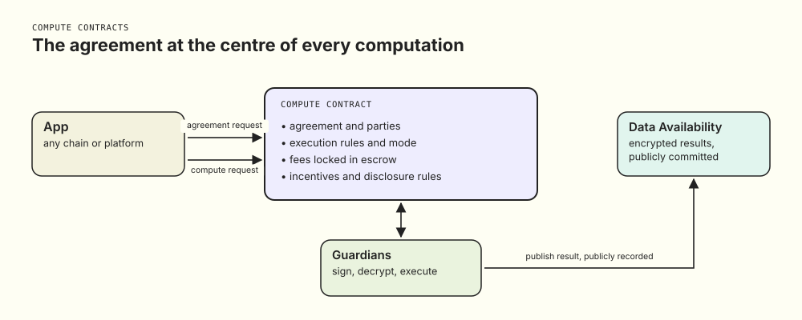
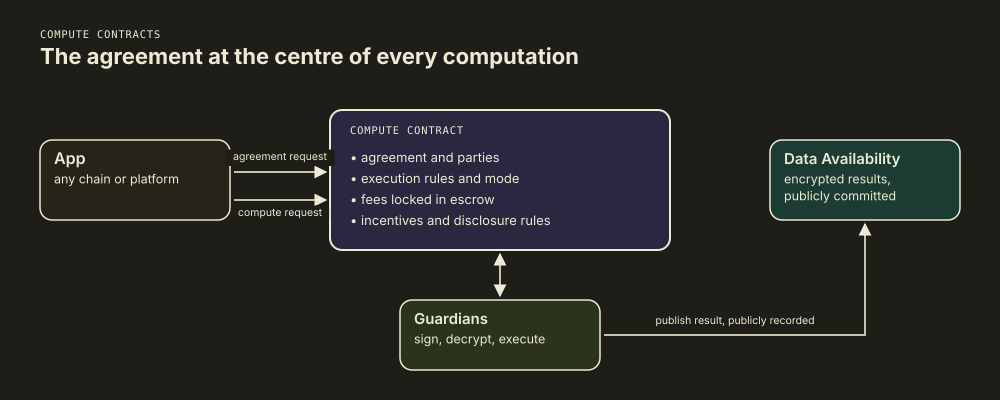
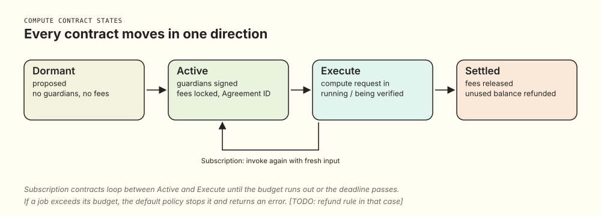
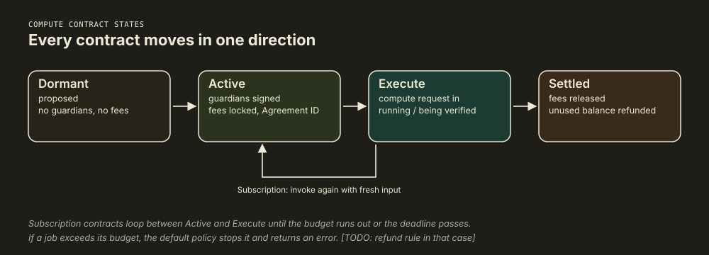
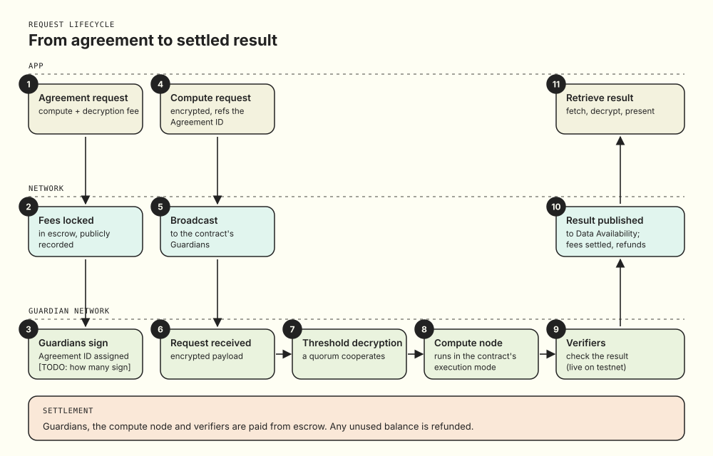
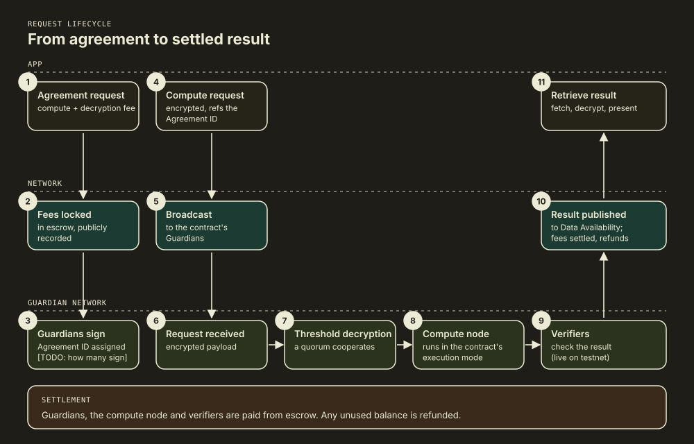

A Compute Contract is one of Palliora's two inventions, with [Accountable Privacy](/learn/concepts/accountable-privacy). It turns an agreement about private computation into something the protocol enforces: what data is used, what runs, who can see the result, and who gets paid. The contract doesn't just describe an agreement. It coordinates the real computation.

<Frame>
  
  
</Frame>

## What it solves

A regular smart contract is good at enforcing simple rules in public, but it can't handle private inputs, large data or heavy computation without either exposing the data or becoming impractical to run. Off-chain computation solves that, but brings trust back: nothing guarantees it ran correctly, privately, or as agreed.

A Compute Contract closes the gap. The terms are public and locked before anything runs. The data and execution stay private. Guardians enforce each step, and the result and payments are recorded. It connects private, off-chain work to public, on-chain accountability.

## What a contract defines

* **Inputs**: which data is used, and where it lives.
* **Computation**: the [Compute Artifact](/learn/concepts/compute-artifacts) to run.
* **Confidentiality**: the execution mode, and who may see what. See [Confidential compute](/learn/concepts/confidential-compute).
* **Roles**: which Guardians, compute nodes and verifiers take part, and who may retrieve the output. See [Actors and roles](/learn/concepts/actors-and-roles).
* **Disclosure rules**: when and how sealed information can be revealed. See [Accountable privacy](/learn/concepts/accountable-privacy).
* **Incentives**: the fee, how it is split, and under what conditions. See [Fees and incentives](/learn/concepts/fees-and-incentives).

Once agreed, the contract is publicly recorded. Guardians enforce it step by step, coordinating data access, computation and verification exactly as specified.

## Contract states

<Frame>
  
  
</Frame>

| State   | What's true                                                                                                                        |
| ------- | ---------------------------------------------------------------------------------------------------------------------------------- |
| Dormant | Proposed. No Guardians assigned, no fees committed.                                                                                |
| Active  | Guardians have signed. Fees are locked and publicly recorded. An Agreement ID is assigned. Ready for a compute request.            |
| Execute | A compute request has been submitted. The job is running or being verified.                                                        |
| Settled | Result finalized, fees paid out, unused balance refunded. A contract also settles when its budget runs out or its deadline passes. |

A `Subscription` contract is invoked repeatedly with fresh encrypted input each time, instead of registering a new contract per call. It returns to Active after each run until its budget or deadline is reached.

## Step by step: agreement to settlement

<Frame>
  
  
</Frame>

The numbered steps are on [How Palliora works](/learn/how-it-works). Verification (step 9 in the diagram) happens only when the contract asks for it. Every Guardian in the assigned group must sign before an agreement is accepted -- on testnet, groups are three Guardians, and the agreement moves to Accepted only once all three approve.

## What it isn't

It isn't a smart contract that runs entirely in public view, a legal agreement written in natural language, or a loose workflow with no enforcement. It's precise enough for the protocol to enforce, flexible enough to support real data and real computation, and it doesn't remove responsibility from participants. It makes each one's responsibility explicit and enforces it.

## How it fits into Palliora

A Compute Contract is the coordination point everything else attaches to. It names a [Compute Artifact](/learn/concepts/compute-artifacts) to run, the [Guardians](/learn/concepts/guardian) who enforce it, the disclosure rules that apply, and the [fee split](/learn/concepts/fees-and-incentives) that pays everyone once it settles.

If you use an app built on Palliora, you'll never touch a Compute Contract directly. If you build on Palliora, or monetize data or a model, this is the mechanism that turns your intent into something the protocol enforces.

## Where to go next

* [Compute Artifacts](/learn/concepts/compute-artifacts): what actually runs inside a contract.
* [Accountable privacy](/learn/concepts/accountable-privacy): how sealed information can be revealed, and by whom.
* [Quickstart](/build/quickstart): create your first Compute Contract.
