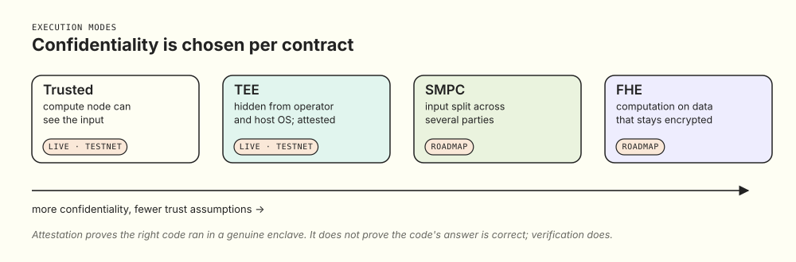
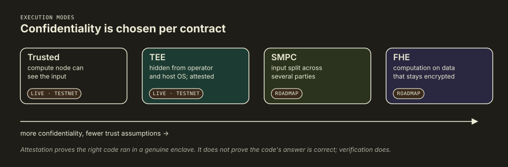

Confidential Compute lets a computation run on sensitive data without exposing that data to whoever is running the computation. In Palliora, data can be processed while staying hidden from infrastructure operators, other network participants, and even the host operating system. Only the outputs the contract allows are ever revealed.

## The problem it solves

A lot of real data can't be shared in plain form: it's commercially sensitive, personally identifiable, or legally restricted. Traditional computation forces a trade-off, either the data is revealed to whoever computes on it, or the computation doesn't happen. Encryption protects data at rest and in transit, but most systems still have to decrypt it before using it. Confidential Compute removes that trade-off: data can be processed without ever being exposed to the machine's operator or any outside observer.

## How it works

Palliora enables Confidential Compute mainly through Trusted Execution Environments (TEEs): a secure enclave inside a processor, a protected memory region where code runs isolated from the rest of the system, including the operating system and its administrators. Data loaded into the enclave can't be read from outside it.

Before computation starts, the enclave produces an attestation report, a cryptographic proof that the enclave is genuine and running the expected code. Verifiers and other participants can check this proof before letting sensitive data anywhere near it. Once verified, encrypted data goes into the enclave, gets decrypted and processed there, and the intermediate state never leaves it.

Data can also be sealed: encrypted with a key derived from inside the enclave itself, so it can't be read outside that specific enclave instance. A contract may require certain operations to run inside a TEE; Guardians coordinate access, a designated compute node executes inside the enclave, and the output is encrypted before it leaves, released according to the contract's rules.

## Execution modes

Every Compute Contract chooses how private its execution is. The choice is explicit, because each mode carries different trust assumptions.

<Frame>
  
  
</Frame>

| Mode    | Who can see the input during execution            | Trust assumption                                                                                     | Status                                               |
| ------- | ------------------------------------------------- | ---------------------------------------------------------------------------------------------------- | ---------------------------------------------------- |
| Trusted | The compute node operator                         | You trust that operator                                                                              | Live (testnet)                                       |
| TEE     | No one outside the enclave, including the host OS | The hardware vendor and a correct TEE implementation; attestation is checked before data is released | Live (testnet), on Guardians with Intel TDX hardware |
| SMPC    | No single party; the input is split               | Not all parties collude                                                                              | Roadmap                                              |
| FHE     | No one; data stays encrypted while computed on    | Cryptographic only                                                                                   | Roadmap                                              |
| ZK      |                                                   |                                                                                                      |                                                      |

Attestation proves the expected code ran in a genuine enclave. It does not prove the code's answer is correct. That's the job of verifiers, which check outputs against the contract's tests.

## Trust and guarantees

Confidential Compute cuts down significantly on the trust required in infrastructure operators. Even a compromised host machine can't read the data or execution inside the enclave. Attestation confirms only approved code is running; sealing stops sensitive material from being extracted or reused outside the trusted boundary.

It doesn't eliminate every trust assumption, though. It relies on hardware security guarantees and a correct TEE implementation, which is why Palliora treats it as one option within a broader confidentiality spectrum, chosen explicitly per contract rather than assumed everywhere.

## What it isn't

Confidential Compute isn't a complete privacy solution on its own. It doesn't replace encryption, access control, threshold decryption, or verification, and it doesn't guarantee a computation's correctness by itself, a computation can still be wrong or malicious if nothing verifies it. That's why Palliora combines it with threshold encryption, Verifiers, and Compute Contracts.

## How it fits into Palliora

Confidential Compute is one of the execution modes a Compute Contract can specify. Guardians coordinate access to the encrypted data, a compute node processes the request inside an enclave, and Verifiers can check the attestation and validate outputs where required. This is what makes private model training, secure data analysis, protected key handling, and agent execution possible without exposing raw inputs.
