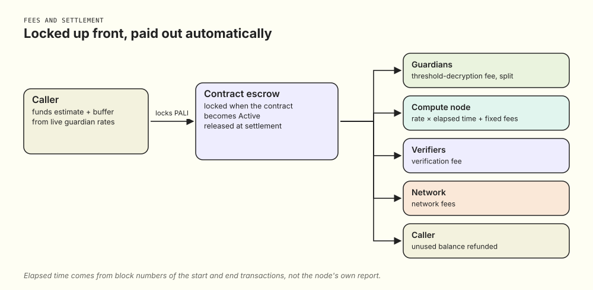
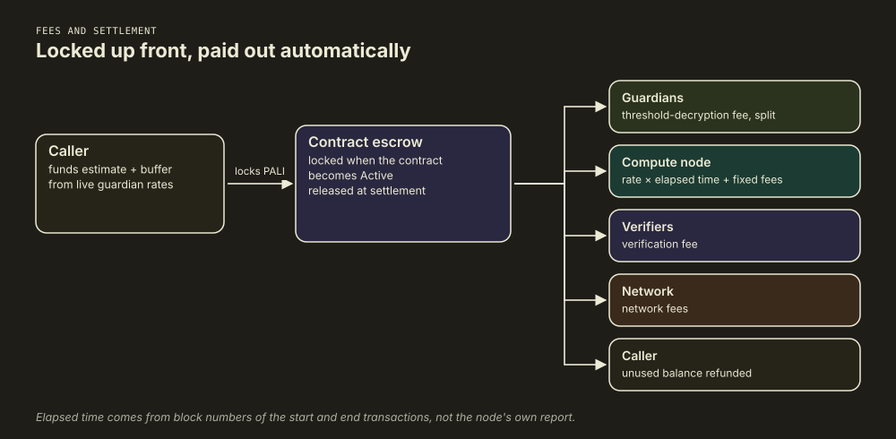

Every Compute Contract locks its fees up front and settles them automatically once a result is verified. Nobody claims a payment manually, the protocol distributes it.

## Who gets paid

<Frame>
  
  
</Frame>

| Fee                           | Paid to          | For                                                                                                                                                                    |
| ----------------------------- | ---------------- | ---------------------------------------------------------------------------------------------------------------------------------------------------------------------- |
| Threshold Decryption Fee      | Guardians        | Split evenly across every Guardian that took part in threshold decryption, cooperating to reconstruct a decryption key without any one of them holding the whole thing |
| Executor Reward (Compute Fee) | The compute node | Running the computation and publishing the encrypted result                                                                                                            |
| Verification Fee              | Verifiers        | Checking the result against the contract's own verification criteria                                                                                                   |
| Network fees                  | Validators       | Recording the contract and its result on the coordination ledger                                                                                                       |
| Unused balance                | The caller       | Refunded at settlement                                                                                                                                                 |
| Publisher price               | The Publisher    |                                                                                                                                                                        |

The fees are locked at agreement time (when the contract becomes Active) and distributed automatically once the result is verified and published. No manual claiming.

## How a fee is priced

Before anything runs, the request goes through a short live auction. Guardians broadcast a rate for the compute type involved, and the best live rate wins, falling back to a base rate if nobody responds in time. Combined with historical run data and a safety buffer, this produces an estimate the caller funds up front, since only the time actually used gets charged, the estimate can safely lean a little high. The `estimateMinFee` SDK call returns this floor, and `getFeeParams` returns the live network parameters it derives from, see [SDK Reference](/build/reference/sdk-reference).

That estimate plus its buffer gets locked into the Compute Agreement as escrow. The blocked amount also functions as the Guardian's signal for the maximum compute budget it should expect before starting work. What happens if a job runs over that budget is an overflow policy set at the same time, currently the default is to kill the job and return an error.

Guardians publish their own rate per hardware type they operate (PALI per minute), but a minimum and maximum guardrail band keeps that rate from being pushed artificially low to win jobs, or unreasonably high in a way that exploits whoever's paying.

## Execution and settlement

A single Guardian executes a given request. It decrypts the input, loads the Compute Artifact if it isn't already warm, runs it, and publishes the encrypted result back to the network. Elapsed time is measured from the block numbers of the start and end transactions, an objective source rather than the Guardian's own self-report.

```
Compute Cost = (Rate × Elapsed Time) + Fixed Fees
Total Cost = Compute Cost + Network Fees
```

Once the end transaction confirms, settlement runs immediately: the runtime pays the Guardian, distributes network fees, refunds whatever balance went unused back to the caller, and marks the contract settled.

## What keeps everyone honest

Every role above has a financial reason to follow the contract rather than cut corners. A Guardian that deviates can be penalized through staking slashing, see [Guardian](/learn/concepts/guardian). A Verifier in the minority on a disputed result loses its fee rather than earning one. A compute node only gets paid for a verified output, not merely an attempted one.

None of this

relies on any party's reputation, it's enforced by the contract and the economics built into it.

## Product fees

Products built on Palliora charge their own usage fees on top: Palliora DeFi about 1 basis point per trade, Palliora AI a usage fee for private compute. Customers pay these in fiat or stablecoins, and PALI settles the computation underneath.
