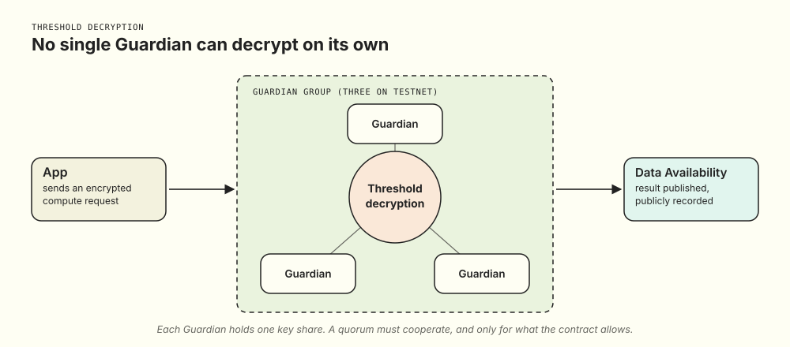
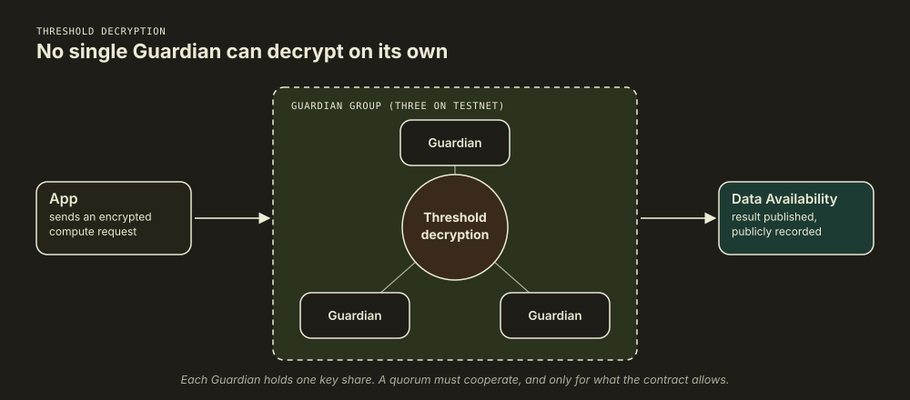

A Guardian is one of the core actors in Palliora. Its job is to make sure data and computation are handled exactly as agreed, even when the data is sensitive and the parties involved don't trust each other.

Think of a Guardian as a neutral enforcer. It doesn't own data, doesn't set protocol policy, and doesn't benefit from bending the rules. It exists to make sure Palliora contracts are executed faithfully and transparently.

<Frame>
  
  
</Frame>

## Why Palliora needs Guardians

Palliora is for sharing data or running computations without giving up control over them. That means enforcing clear rules about who can access data, how computations run, and when results get revealed.

A public ledger is good at recording agreements but not at handling private data or heavy computation. Centralized servers can do those things, but they require trust in whoever runs them. Guardians bridge that gap: they coordinate data access and computation privately, while staying accountable to the publicly recorded contract that defines what's allowed.

## How Guardians operate

Guardians don't act individually. For most actions, a predefined quorum is required, so no single Guardian can unilaterally release data or override a contract's conditions. A threshold of participating Guardians has to cooperate before any sensitive action happens, which protects against a single compromised or malicious node.

"Guardian" is an umbrella term. A Guardian node may coordinate data access and enforcement, perform computation as a compute node, or verify inputs and outputs as a Verifier. These roles are defined explicitly in the contract and paid separately. Guardians generally don't need to see the underlying data at all: it's typically encrypted or split into shares, so they can enforce the rules without learning anything sensitive. The exception is trusted execution: a Guardian acting as the compute node in trusted mode does see the input. See [Confidential compute](/learn/concepts/confidential-compute).

Guardians also review disclosure requests. A sealed record is revealed only when a quorum of Guardians approves a signed, publicly logged request. See [Accountable privacy](/learn/concepts/accountable-privacy).

## Trust and accountability

Guardians aren't trusted because they're elected or centrally appointed. They're trusted because they have economic stake and cryptographic accountability. To participate, a Guardian stakes tokens as collateral. Every action is signed, recorded, and tied to a specific contract. A Guardian that deviates from the contract can be penalized financially.

The network stays secure even if some Guardians are malicious or unavailable, through quorum requirements and Byzantine fault tolerant coordination. Every Guardian action is signed, recorded, and publicly auditable.

One current limit: if a Compute Contract names a Guardian that is offline, the request waits instead of failing. Name Guardians you know are live. See [Troubleshooting](/build/reference/troubleshooting).

## What Guardians don't do

Guardians don't set monetary policy, adjust inflation, or decide protocol upgrades, and they aren't a governance council. Their responsibility is operational: enforce contracts, coordinate execution, and uphold the integrity of data handling. Governance, where it exists, is handled separately at the protocol level.

## How Guardians fit into Palliora

Guardians sit at the center of Palliora's execution layer. Data Availability makes sure data exists and stays retrievable. Compute Contracts define the rules of engagement. Validators secure the ledger that records those rules and their outcomes. Guardians make sure real-world execution actually matches what was agreed, even when confidentiality, verification, and economic incentives are all involved at once.
