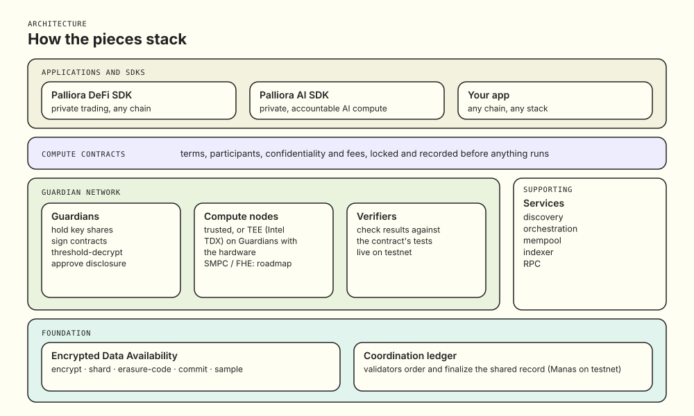
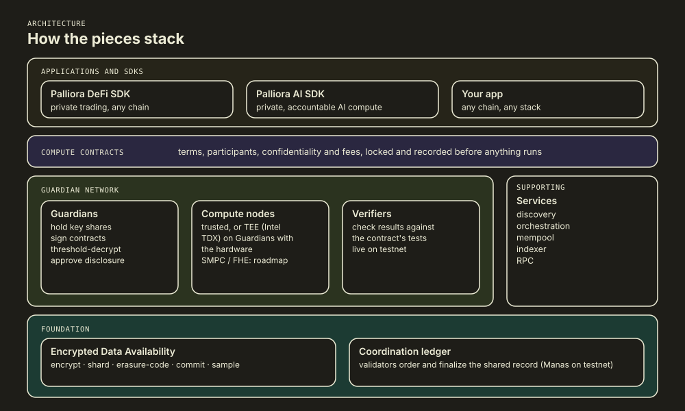
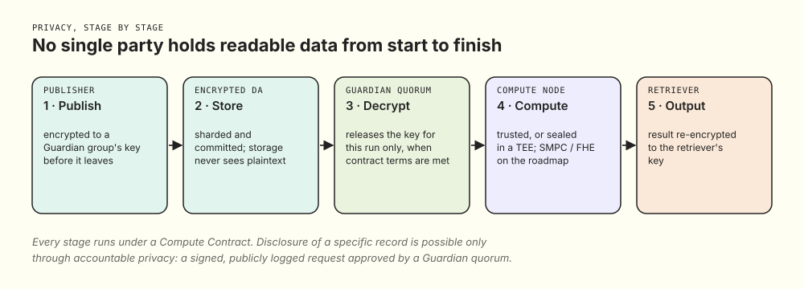
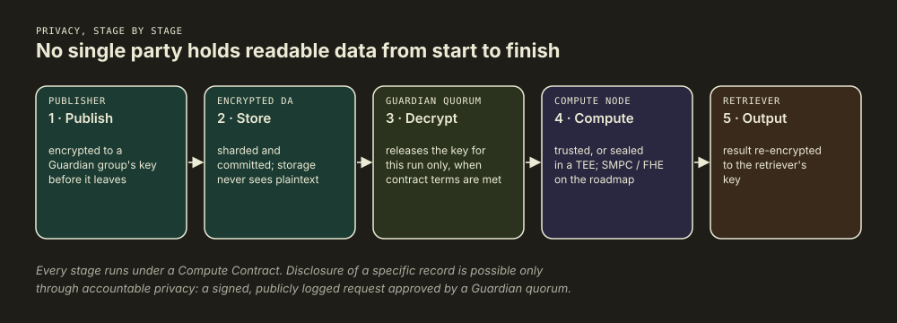

Palliora has three layers: applications and SDKs on top, the Guardian network in the middle, and encrypted data availability plus a coordination ledger underneath. Compute Contracts tie them together.

Applications don't move to Palliora. They stay on the chain or platform they already use and call Palliora when they need private, verifiable computation. See [Where Palliora runs](/learn/where-palliora-runs).

<Frame>
  
  
</Frame>

## The layers

* **Applications and SDKs.** Palliora DeFi, Palliora AI, or any app. They create Compute Contracts and read results. In a production integration, end users never deal with Palliora directly.
* **Compute Contracts.** The agreement that ties everything together: what runs, on whose data, which Guardians are involved, the confidentiality level, what it costs, and who gets paid. Locked and recorded before anything executes. See [Compute Contracts](/learn/concepts/compute-contracts).
* **Guardian network.** Guardians hold key shares, sign contracts, threshold-decrypt inputs and approve disclosure. Compute nodes run the actual workload. Verifiers check outputs against the contract's own tests. One physical node can play several of these roles. See [Guardian](/learn/concepts/guardian) and [Threshold encryption](/learn/concepts/threshold-encryption).
* **Services.** Discovery, orchestration, mempool, indexer and RPC, so applications can find Guardians and submit requests.
* **Encrypted Data Availability.** Data is encrypted, sharded, erasure-coded and committed with KZG commitments. Nodes confirm availability by sampling, not downloading everything. See [Data availability](/learn/concepts/data-availability).
* **Coordination ledger.** A proof-of-stake validator set orders and finalizes the shared record of agreements, results, disclosure requests and payments. On testnet this ledger is Manas. See [Validator](/learn/concepts/validator).

## Who does what

| Role         | What they do                                                                      |
| ------------ | --------------------------------------------------------------------------------- |
| Publisher    | Uploads data or a Compute Artifact, sets the access rules and price               |
| Retriever    | Requests access to data or a result, pays the agreed fee                          |
| Guardian     | Coordinates access, holds a key share, enforces the contract, approves disclosure |
| Compute node | Runs the computation, in the execution mode the contract specifies                |
| Verifier     | Checks the result against the contract's own tests                                |
| Validator    | Orders transactions and finalizes the coordination ledger                         |

A Guardian node can serve more than one of these roles at once. Which role applies to a given request depends on its configuration and what the contract asks for. See [Actors and roles](/learn/concepts/actors-and-roles) for how each role gets paid.

## The lifecycle of a request

1. **Agreement.** The app builds a Compute Contract agreement request: price, the Guardians involved, and the execution rules. It sends this to an RPC node.
2. **Funds locked.** The request enters the mempool, the fee is locked in escrow, and the request goes to the selected Guardians.
3. **Guardians sign.** Every Guardian in the assigned group signs before the contract is recorded with an Agreement ID (also called a Contract ID, or CID). On testnet, groups are three Guardians.
4. **Compute request.** The app submits the actual request, referencing the Agreement ID, with the payload encrypted so no single Guardian can read it.
5. **Threshold decryption.** A quorum of Guardians decrypts the payload together.
6. **Execution.** The payload goes to a compute node, running in the execution mode the contract specified.
7. **Result.** The result is published, encrypted, to the Data Availability layer.
8. **Verification.** Where the contract asks for it, a verifier checks the result against the contract's tests.
9. **Settlement.** The ledger finalizes the result, pays Guardians, the compute node and verifiers, and refunds any unused balance.
10. **Retrieval.** The app reads the result and decrypts it for the user.

If a specific record later needs to be revealed, that happens only through a signed, publicly logged disclosure request approved by a Guardian quorum. See [Accountable privacy](/learn/concepts/accountable-privacy).

Because execution happens off the public record, a result typically lands a handful of blocks after the request. The same flow is drawn as a diagram on [Compute Contracts](/learn/concepts/compute-contracts).

## Privacy, stage by stage

The same journey from the data's point of view. At each stage a different party holds the data, and no single party holds it in readable form from start to finish.

<Frame>
  
  
</Frame>

| Stage      | Who is responsible          | What happens                                                                                                                                                                                      |
| ---------- | --------------------------- | ------------------------------------------------------------------------------------------------------------------------------------------------------------------------------------------------- |
| 1. Publish | Publisher                   | Data is encrypted to a Guardian group's key before it leaves the publisher's machine.                                                                                                             |
| 2. Store   | Encrypted Data Availability | The encrypted data is sharded, erasure-coded and committed. Storage nodes never see it in the clear.                                                                                              |
| 3. Decrypt | Guardian quorum             | When a Compute Contract's conditions are met, a quorum of Guardians releases the key for that run only.                                                                                           |
| 4. Compute | Compute node                | The workload runs in the execution mode the contract chose: trusted (the operator can see the input), TEE (sealed in an enclave), or, on the roadmap, SMPC or FHE (never decrypted in one place). |
| 5. Output  | Retriever                   | The result is re-encrypted to the retriever's key before it leaves the compute node.                                                                                                              |

The Quickstart and the plaintext guides skip stages 1 and 3 on purpose, so you can watch every step. Use [Encrypted compute](/build/guides/encrypted-compute) for the private path.

## Current testnet numbers

As of October 2026, Manas runs roughly 700 transactions per second with 6-second blocks. It uses BABE for block production and GRANDPA for finality, which gives finality in 15 to 20 seconds. New Guardians are admitted every 4 hours. These are testnet figures and will change as the network matures. See [Network reference](/build/reference/network-reference) for current values.
