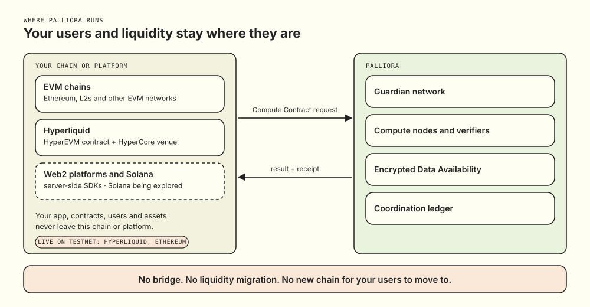
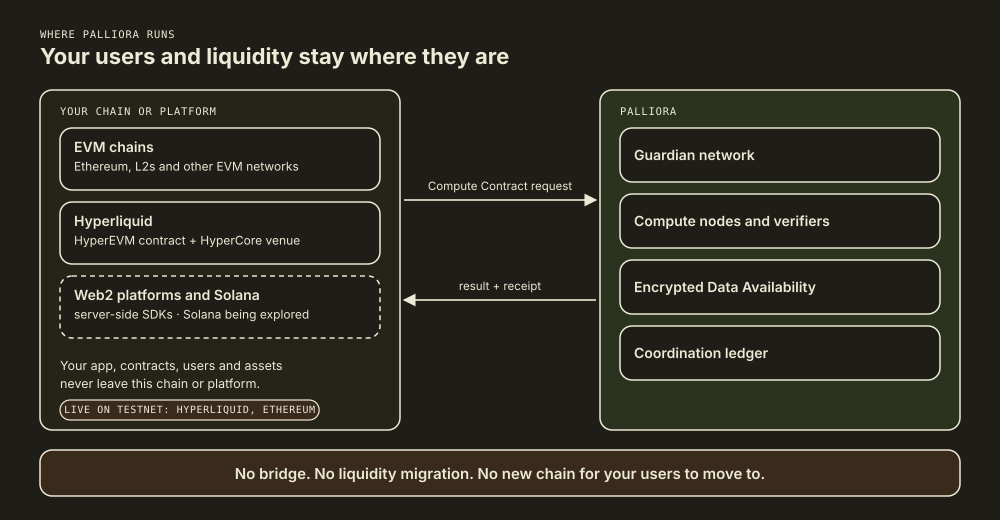

Palliora is not a chain your users move to. Applications keep their users, contracts and liquidity on the chain they already use, and call Palliora for private, verifiable computation.

<Frame>
  
  
</Frame>

## How an app on another chain uses Palliora

1. The application's contract or backend creates a Compute Contract request: what to run, on which encrypted inputs, under which rules.
2. Palliora's Guardians and compute nodes run it and record the agreement and result on the coordination ledger.
3. The application receives the result and a receipt it can check.

## Supported environments

| Environment                          | Status                     | Notes                                                                   |
| ------------------------------------ | -------------------------- | ----------------------------------------------------------------------- |
| Manas (Palliora testnet)             | Live (testnet)             | All current SDK flows run here.                                         |
| EVM chains                           | Live (testnet) on Ethereum | Through Palliora DeFi.                                                  |
| Hyperliquid (HyperEVM and HyperCore) | Live (testnet)             | Through Palliora DeFi. See [Palliora DeFi](/products/palliora-defi). |
| Solana                               | Exploring                  |                                                                         |
| Web2 platforms (server-side)         |                            | Platforms call Palliora from their backend through the SDKs.            |

## Why this matters

* **No bridge.** Assets are never wrapped or moved to a Palliora chain, so there is no bridge to trust or exploit.
* **No liquidity migration.** Trades and positions stay on the venue where the liquidity already is.
* **No new chain for users.** Users keep their wallets and the apps they already use.

The coordination ledger (Manas on testnet) is infrastructure for Guardians and validators. It records agreements, results and payments. Application users don't need to hold assets there. In production, customers pay in fiat or stablecoins and never need PALI. On testnet, the Quickstart and the demo apps still use a Manas account and test PALI.

Keep every status on this page in line with [Status and roadmap](/learn/status-and-roadmap).
