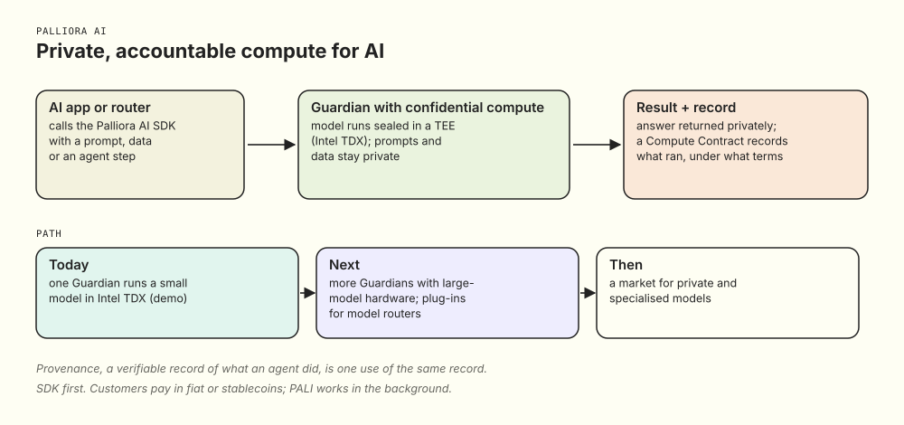
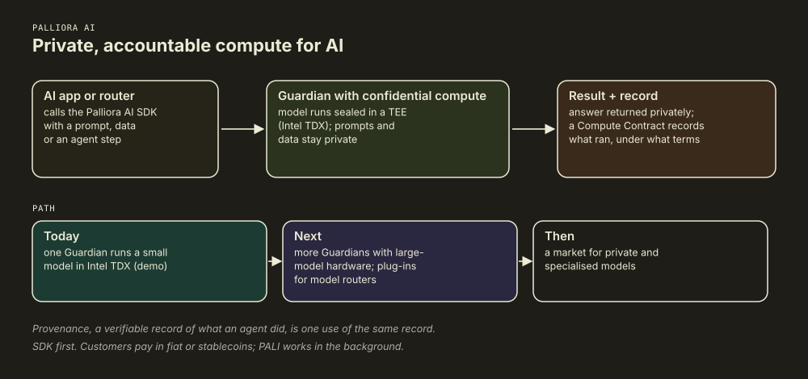

**Private, accountable compute for AI.**

*Private data. Accountable agents.*

Palliora AI lets AI run on private data. Prompts, data and models stay sealed while they run, and every run leaves a record anyone can check of what ran and under which terms. The record is held by independent Guardians, not by the platform that ran the model.

<Frame>
  
  
</Frame>

## What it solves

People and businesses increasingly hand private data to AI, and have no way to check what happened to it. Agents act on people's behalf, and the only record of what they did is a log the platform can edit.

## How it works

* **Private compute.** Models run inside a trusted execution environment (Intel TDX) on Guardians that have the hardware. Prompts and data stay private while they run.
* **Accountable by design.** Every run is a [Compute Contract](/learn/concepts/compute-contracts): which model, on what data, under what terms, recorded before anything executes.
* **Provenance.** Linking those records together gives a verifiable record of what an agent did: which models ran and which tools were called. Provenance is one use of private, accountable compute, not the whole product.
* **SDK first.** AI apps and model routers integrate the Palliora AI SDK. Customers pay in fiat or stablecoins; PALI works in the background.

## Path

| Stage | What it covers                                           | Status        |
| ----- | -------------------------------------------------------- | ------------- |
| Today | One Guardian runs a small model inside Intel TDX         | Testnet, demo |
| Next  | More Guardians with hardware for large models            | Planned       |
| Next  | Plug-ins for model routers such as OpenRouter and Venice | In progress   |
| Then  | A market for private and specialised models              | Planned       |

## Who it's for

* Model routers and AI platforms that want to offer private, accountable inference.
* Agent builders and coding tools that want a provenance record for every run.
* Enterprise AI teams working with sensitive data.

## Pricing

To be announced.

## Status

Palliora AI's SDK is in development on testnet. The demo app, AI Workbench, is live at [ai.palliora.org](https://ai.palliora.org/), see [Try the demo app](https://github.com/palliora-org/palliora-docs-with-ai/tree/main/ai/use/demo-apps.md). Model-router plug-ins are in progress. To build the same pattern yourself, see [Build a chat-completions-compatible service](https://github.com/palliora-org/palliora-docs-with-ai/tree/main/ai/build/guides/chat-completions-service.md).

Read the full Palliora AI documentation: [https://docs.palliora.org/ai](/ai)
