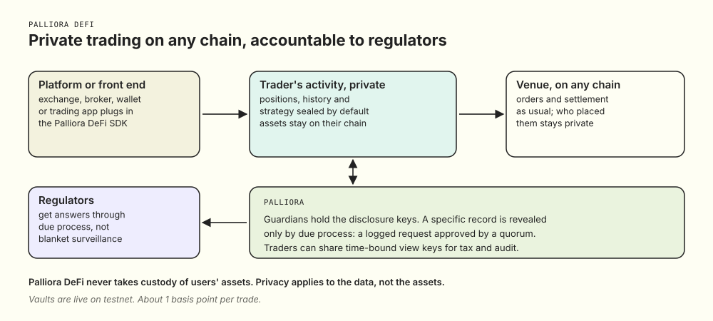
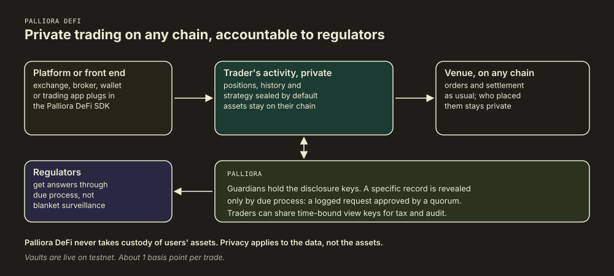

**Private trading on any chain, accountable to regulators.**

*Privacy for traders. Answers for regulators.*

Palliora DeFi lets traders keep their positions, history and strategy private on the chains and venues they already use. Regulators can still get answers, through due process, using Palliora's [accountable privacy](/learn/concepts/accountable-privacy).

Palliora DeFi has two offerings. An **SDK** that exchanges, brokers, wallets and trading front ends integrate to offer accountable privacy to their users. It also has a **live product** on mainnet, with an app anyone can use today. Palliora DeFi was formerly called Veilnyx.

<Frame>
  
  
</Frame>

## What it solves

On public chains, every wallet, position, size and timing is visible. Traders get copied and front-run, and institutions can't trade without showing their hand. Platforms that want to offer private trading also need to be able to answer a lawful request.

## How it works

* **Plug and play.** A platform adds the Palliora DeFi SDK. There is no bridge, no wrapped asset and no separate liquidity.
* **Never takes custody.** Users' assets stay on their own chain, under their own control. Privacy applies to the data about the trade, not to the assets.
* **Private by default.** Who placed which trade stays sealed. Orders, prices and settlement on the venue work as they do today.
* **Accountable by design.** A specific record can be revealed only through a signed, publicly logged request approved by a quorum of Palliora Guardians. Traders can also share time-bound view keys for tax and audit.

## Live now

 <a href="https://defi.palliora.org" className="gb-button gb-button-primary">Palliora DeFi app</a>

The app is live at [**defi.palliora.org**](https://defi.palliora.org). Create a shielded account, deposit, send, swap, lend, stake and trade from one private balance.

* **Mainnet.** Palliora DeFi runs on **Ethereum** and **HyperEVM**. Contract addresses, launch limits and fees are in the [Palliora DeFi documentation](/defi).
* **Private payments.** Deposit, send and withdraw on both mainnets. Senders, receivers, tokens and amounts stay hidden.
* **Private DeFi on Ethereum.** Swap on Uniswap, lend on Aave, stake on Lido and deposit into Morpho vaults from a shielded balance, through adaptors. The protocols do not change.
* **Private trading on Hyperliquid.** From HyperEVM, trade perpetuals with **Private Sub-accounts**: private funding of a public position. Size and direction stay public on Hyperliquid. What is hidden is the link between the trading address and you.

## Built on Palliora

* **Accountable privacy.** A revoker and a threshold of Decom guardians can de-anonymize one transaction together. The guardian and revoker network runs live. There is no master key.
* **Palliora Data Availability.** The revoker keeps what it de-anonymized as an encrypted report. Palliora's silent threshold encryption and Palliora Guardians protect it, and a Compute Contract coordinates storing and retrieving it for the authorized actors. The revoker, or a third party the revoker grants access to, can read it.

## Security and trust

* **Audit.** ABDK audited the protocol and circuits. Both Critical findings and all eight Major findings were fixed. The Hyperliquid components were reviewed internally.
* **ZK ceremony.** The proving keys come from a public Phase 2 ceremony, finalised on 2026-07-15 with 372 contributions.
* **Disclosure contact:** [security@palliora.org](mailto:security@palliora.org).

## Who it's for

* **Exchanges, brokers, wallets and trading front ends** that want to offer private payments, private DeFi or private trading to their users. They integrate the SDK.
* **Trading firms and institutions** that need execution without exposing strategy, and need to answer a lawful request.
* **Anyone** who wants private payments and private DeFi from one shielded balance. Use the app.

## Status

Palliora DeFi is live on Ethereum mainnet and HyperEVM mainnet, and on two testnets: Sepolia and HyperEVM testnet. Launch limits are in force while the protocol is young, and they will be increased in steps. Addresses, limits and fees are in the Palliora DeFi docs. For what is live across Palliora, see [Status and roadmap](/learn/status-and-roadmap).

## Read the docs

The Palliora DeFi docs cover how it works, the SDK, adaptors, Private Sub-accounts, the relayer API and more.

<a href="/defi" className="gb-button gb-button-primary">Palliora DeFi Docs</a>
