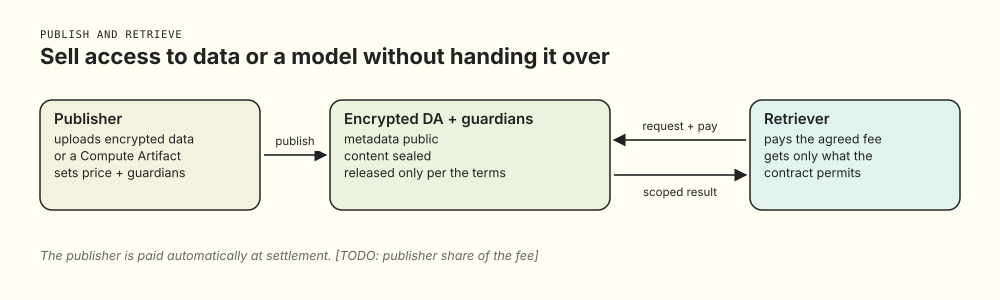
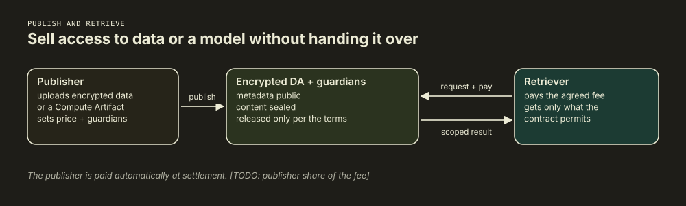

Anyone can publish data or a model on Palliora and set a price for access, you're acting as a [Publisher](/learn/concepts/actors-and-roles) in Compute Contract terms. Whoever wants to use what you've published becomes a [Retriever](/learn/concepts/actors-and-roles) and pays the price you set.

## Steps

1. Go to the Data / Models tab and click **Upload**.
2. Fill in a name, a description, and any reference material that helps someone decide whether they want access.
3. Set the price you want to charge for access.
4. Select the guardian group that will enforce access to your upload, the group you pick is who coordinates decryption and enforces your pricing terms on your behalf, see [Guardian](/learn/concepts/guardian).
5. Sign the transaction to confirm the upload.

<Frame>
  
  
</Frame>

## What happens after you upload

Your data or model is encrypted and stored through Palliora's [Data Availability](/learn/concepts/data-availability) layer, it's never stored in plaintext. The metadata describing it (name, description, price) is public so people can find and evaluate it, the content itself isn't. When someone pays to access it, the guardian group you selected coordinates decrypting it for them specifically, under the terms you set, the same mechanism covered in [Compute Artifacts](/learn/concepts/compute-artifacts) for published models.

You are paid automatically when someone pays for access.

## Doing this programmatically

Uploading through the app is the simplest path. If you're publishing from your own code instead, see [Compute Artifacts: publish and run](/build/guides/compute-artifacts) in the Build section for the underlying SDK calls.
